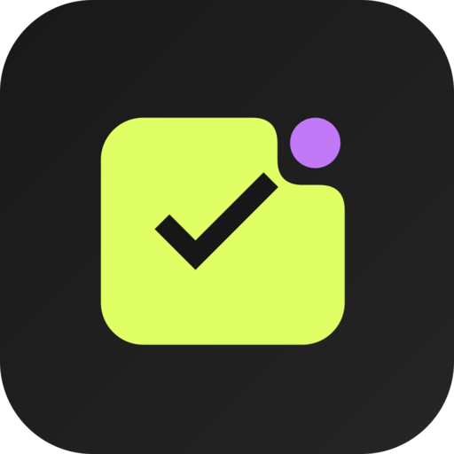
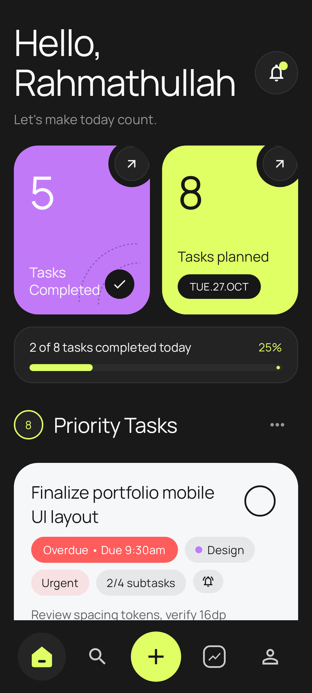
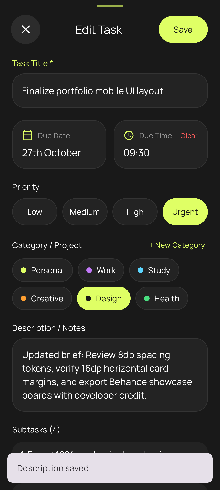
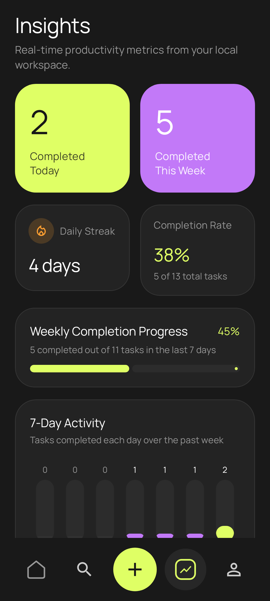
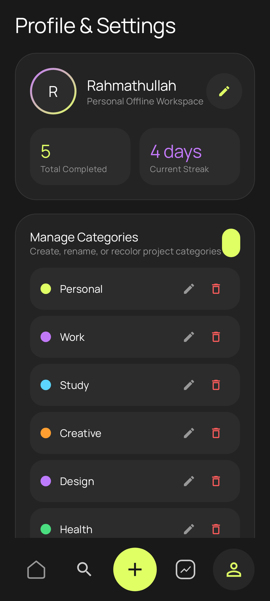

<div align="center">



# DAYFORM

**A native Android task planner for keeping daily work, deadlines, and priorities in order.**

Kotlin · Jetpack Compose · Room · DataStore · Offline-first

</div>

## About

DAYFORM is a native Android task-management app with an uncluttered dark interface. Plan tasks, organize projects into categories, set reminders, follow upcoming deadlines, and review personal productivity trends. A new install starts with an empty task list, not demo tasks.

## Features

- Create, edit, duplicate, complete, and delete tasks and subtasks.
- Assign categories, priority levels, dates, and reminder times.
- View your schedule with task search, filters, and a calendar.
- Track completion, streaks, and category-level insights.
- Manage notification, haptic feedback, time-format, and other preferences.
- Export and import your workspace as JSON; merge or replace data through the app's own controls.
- Store tasks locally using Room and preferences using DataStore.

## Preview

The Home, task editor, insights, and settings images are **automated test-rendered UI captures** supplied with the source project, not independently verified physical-device screenshots. They show a populated example workspace; a new install has no sample tasks.

| App icon | Home | Task editor | Insights | Settings |
| :---: | :---: | :---: | :---: | :---: |
|  |  |  |  |  |

## Requirements

- **Android 7.0 (API 24) or newer** (see `minSdk` in Gradle).
- For source builds: Android Studio, **JDK 21**, an Android SDK with **API 36.1** installed, and an internet connection to resolve Gradle dependencies.
- Uses the checked-in Gradle wrapper and a local Android SDK. No cloud service or API key is needed for the app's current feature set.

## Get the app

**Once a signed release has been built and published**, open the repository's **Releases** tab and download `DAYFORM-v1.0.0.apk`. Check the included SHA-256 digest before installation. Android may ask you to allow installation from your browser or file manager.

> **Publication status:** The source repository is prepared, but a signed release APK is not included in this source archive. The supplied existing APK was a debug build and must not be represented as an official release. See [Release guide](docs/RELEASE.md) and [Windows signing setup](docs/SIGNING_SETUP_WINDOWS.md).

## Build from source

```bash
git clone https://github.com/designwithrahma/dayform.git
cd dayform
./gradlew :app:assembleDebug
```

On Windows, run `gradlew.bat :app:assembleDebug`. Install the debug output from `app/build/outputs/apk/debug/` on a test device. See [Build guide](docs/BUILD.md) for SDK setup, tests and release signing.

## Source layout

```text
app/src/main/             Android app, Kotlin source, resources
app/src/test/             Local unit and Robolectric tests
app/src/androidTest/      Instrumentation tests
app/schemas/              Versioned Room database schemas
gradle/                   Version catalog and Gradle wrapper
.github/workflows/        Continuous integration and draft release workflow
docs/                     Architecture, build, release and security details
```

## Permissions and data

The app requests notification and alarm-related permissions to schedule local reminders: `POST_NOTIFICATIONS`, `RECEIVE_BOOT_COMPLETED`, `VIBRATE`, and `SCHEDULE_EXACT_ALARM`. Exact alarm access may need explicit user approval on some Android versions. The manifest does **not** request `INTERNET`. Android cloud backup is disabled in the app manifest; users can manually export/import JSON backups. [Privacy details](docs/PRIVACY.md).

**Important:** Keep exported JSON files secure because they may contain personal task information. Uninstalling without a backup may remove your data.

## Contributing and support

Contributions and reproducible bug reports are welcome. Start with [CONTRIBUTING.md](CONTRIBUTING.md). Security vulnerabilities should be reported through the [security policy](SECURITY.md), not public issues.

- [Changelog](CHANGELOG.md)
- [Architecture](docs/ARCHITECTURE.md)
- [Building & testing](docs/BUILD.md)
- [Release process](docs/RELEASE.md)
- [Credits & third-party licenses](docs/THIRD_PARTY_NOTICES.md)
- [Code of conduct](CODE_OF_CONDUCT.md)

## License

Source code is offered under the **MIT License** in [LICENSE](LICENSE), subject to the contributor/maintainer having the necessary rights to license the original work. Third-party components, including the Manrope font and AndroidX libraries, retain their respective licenses; see [notices](docs/THIRD_PARTY_NOTICES.md). Existing in-app developer attribution has been preserved.
