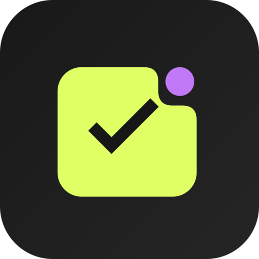
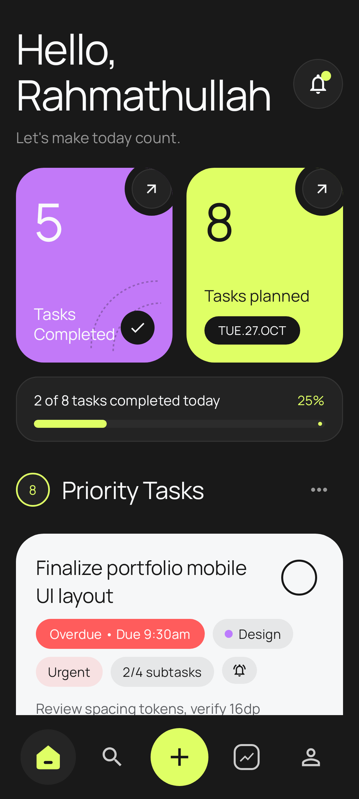
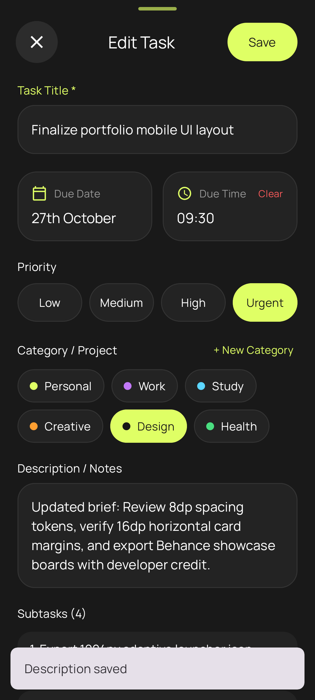
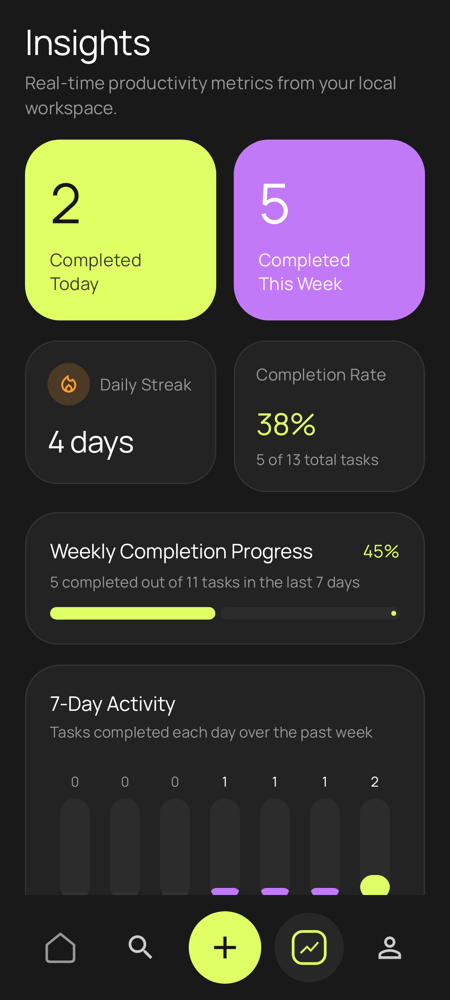
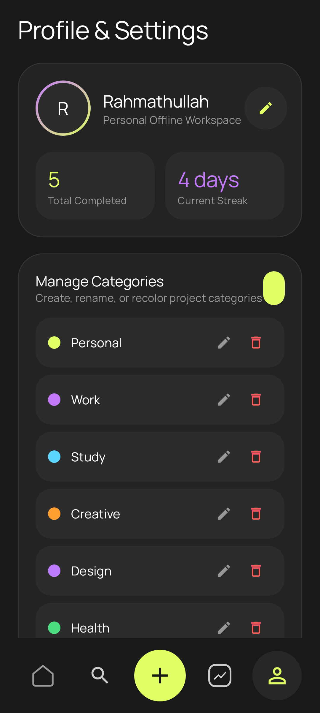

# DAYFORM

**An offline Android task manager for tasks, reminders, and daily planning.**

A focused, native to-do list and productivity planner built with **Kotlin** and **Jetpack Compose**. Organize what matters, plan your day, and keep your tasks on your device.

**[Screenshots](#screenshots) · [Get the APK](#download-and-install) · [Features](#features) · [Build from source](#build-from-source)**

---

## Why DAYFORM?

DAYFORM is a personal task planner for Android with a clean, dark interface and a local-first approach. Create a simple to-do list, break big tasks into subtasks, schedule reminders, browse your calendar, and see your progress—all without creating an account.

**No sign-up. No internet connection required for day-to-day task management.** Your tasks are stored locally, with JSON export and import available when you want to back them up or move them.

## Screenshots

These are **automated test-rendered app UI captures**, not photographs of a physical device. They show an example workspace; a fresh installation starts with an empty task list.

| Home | Task editor | Insights | Settings |
| :---: | :---: | :---: | :---: |
|  |  |  |  |

## Features

- **Tasks and subtasks:** create, edit, duplicate, complete, and delete tasks; split larger work into smaller steps.
- **Due dates and reminders:** plan deadlines and set local task notifications, subject to Android notification and alarm permissions.
- **Priorities and categories:** group tasks and highlight what needs attention first.
- **Calendar and search:** find tasks using search and filters, and view scheduled work on a calendar.
- **Productivity insights:** review task completion, streaks, and category-level progress.
- **Personal preferences:** adjust notification settings, haptic feedback, time format, and related options.
- **Manual backup and restore:** export your workspace as JSON and import it later, with merge or replace options.
- **Offline-first storage:** tasks use Room/SQLite, while settings use Android DataStore.

DAYFORM does not include built-in cloud synchronization. The app's source manifest does not request the Android `INTERNET` permission.

## Download and install

**Public release status:** DAYFORM `v1.0.0` has a signed *draft* release, but the APK has **not yet been published for public download**. The draft must be reviewed against the current source and tested on Android devices before publication.

When the release is published:

1. Open **[DAYFORM GitHub Releases](https://github.com/designwithrahma/dayform/releases)**.
2. Download `DAYFORM-v1.0.0.apk` from the published release assets.
3. Compare its SHA-256 hash with the accompanying `SHA256SUMS.txt`.
4. Install it on Android 7.0 or later. Android may ask you to allow installation from your browser or file manager.
5. Allow notifications and, where required, exact-alarm access to receive reminders.

**Important:** Back up existing tasks before uninstalling or changing app signing versions. A release-signed APK may not install directly over an older debug-signed build. See the [release guide](docs/RELEASE.md) for the validation process.

## Privacy and local data

DAYFORM is designed to keep your task data on your Android device.

| Area | How it works |
| --- | --- |
| Task data | Stored locally with Room / SQLite |
| Preferences | Stored locally with DataStore |
| Account | No account required |
| Internet | No `INTERNET` permission in the current app manifest |
| Backups | User-controlled JSON export and import |
| Android cloud backup | Disabled in the app manifest |
| Reminders | Local Android alarms and notifications |

Exported JSON files may contain personal information. Store them securely and review where you share them. Uninstalling the app without exporting a backup may delete your data. Read the full [privacy notes](docs/PRIVACY.md).

## Requirements

**To use the app:** Android **7.0 (API 24)** or newer. Some Android versions require you to grant notification and exact-alarm permissions for scheduled reminders.

**To build the app:** Android Studio, **JDK 21**, Android SDK **API 36.1**, and an internet connection to download Gradle dependencies. No external cloud service or API key is needed for the current app features.

## Build from source

Clone the public Android project and build a **debug APK for local testing**:

~~~bash
git clone https://github.com/designwithrahma/dayform.git
cd dayform
./gradlew :app:assembleDebug
~~~

On Windows, run `gradlew.bat :app:assembleDebug`.

The debug APK is created at `app/build/outputs/apk/debug/app-debug.apk`. It is **not** a signed production release and should not be presented as one.

To run the project's core tests and lint checks:

~~~bash
./gradlew :app:testDebugUnitTest --tests com.example.DayformUnitTest --tests com.example.DayformRobolectricTest
./gradlew :app:lintDebug
~~~

Read [BUILD.md](docs/BUILD.md) for the full setup, [RELEASE.md](docs/RELEASE.md) for signed APK publishing, and [SIGNING_SETUP_WINDOWS.md](docs/SIGNING_SETUP_WINDOWS.md) for private signing-key setup. Never commit keystores or signing passwords.

## Tech stack

| Technology | Role |
| --- | --- |
| **Kotlin** | Android application language |
| **Jetpack Compose + Material 3** | Native Android interface |
| **Room / SQLite** | Local task database |
| **DataStore** | Local app preferences |
| **AlarmManager** | Scheduled reminders |
| **Gradle + GitHub Actions** | Builds, automated checks, draft-release workflow |

The application ID is `com.designwithrahma.dayform`. The source uses the existing `com.example` Kotlin namespace for compatibility.

## Project structure

~~~text
app/src/main/            App UI, logic, database, notifications
app/src/test/            Unit and Robolectric tests
app/src/androidTest/     Android instrumentation and screenshot tests
app/schemas/             Versioned Room database schemas
.github/workflows/       Android CI and signed draft-release workflow
docs/screenshots/        Automated UI preview captures
docs/                    Architecture, privacy, building and release docs
~~~

## Frequently asked questions

**Can I use DAYFORM without internet?**  
Yes. The current task-management features work offline, and task data is stored on the device.

**Do I need to register or sign in?**  
No. DAYFORM does not require an account.

**Can I move my tasks to another phone?**  
You can manually export your data as JSON and import it on another device. This is not automatic sync.

**Is DAYFORM open source?**  
Yes. The source is available in this repository under the MIT License, subject to the included third-party notices.

## Contributing and project documentation

Bug reports, reproducible issues, and contributions are welcome. Read [CONTRIBUTING.md](CONTRIBUTING.md) before opening a pull request. Please report security vulnerabilities privately as described in [SECURITY.md](SECURITY.md).

- [Changelog](CHANGELOG.md)
- [Architecture](docs/ARCHITECTURE.md)
- [Build and test guide](docs/BUILD.md)
- [Signed release guide](docs/RELEASE.md)
- [Privacy details](docs/PRIVACY.md)
- [Third-party notices](docs/THIRD_PARTY_NOTICES.md)
- [Code of conduct](CODE_OF_CONDUCT.md)

## License

DAYFORM is distributed under the [MIT License](LICENSE). Copyright © 2026 Mohammed Rahmathullah. Third-party libraries, fonts, and assets retain their own licenses and notices. Existing in-app attribution is preserved.
